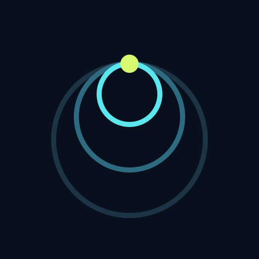

<div align="center">



# T E L O S

*From the Greek τέλος: the purpose you build toward.*

<sub>research · design · systems</sub>

</div>

---

Every project starts as a point on the horizon. We build tools that help small teams reach it, with evidence at every step.

### ✦ Currently building: NOVA

*A shared space for turning possibilities into reality.*

| ◎ Explore | ◈ Build | ✳ Grow |
|:---:|:---:|:---:|
| A living map of what the world is researching, building and still trying to solve | Shared project spaces where every checkpoint keeps its evidence | Personal spaces that value saved work, not time spent online |

### How we work

```
purpose  →  evidence  →  progress
```

- **Start with the why.** Every feature traces back to a real need.
- **Evidence over enthusiasm.** Checkpoints, not claims.
- **Calm by design.** Progress, not streaks.

<div align="center">
<br>
<sub>Early days · Building in the open · <code>team@yourdomain.com</code></sub>
</div>
